# Early quality prediction and steering for SD 3.5 Medium: progress report

**Model:** Stable Diffusion 3.5 Medium. **Quality metric:** ImageReward. **Hardware:** a single RTX 5080 (16 GB).
Code and setup are described in [README.md](README.md).

## TL;DR

1. **The released ProbeSelect SD3-M probe does not rank candidates in our tests.** We matched the published code and
   checkpoint exactly. On 10 prompts × 8 seeds the mean within-prompt Spearman ρ was −0.05, and it picked the best
   image 0 times out of 10.
2. **ProbeSelect's data generator has a batching bug.** With CFG and batch size > 1, the `[0::2]` feature slice pairs
   features with the wrong image. The released probe's scores mostly separate prompts from each other, not
   candidates of the same prompt. That is consistent with the bug, but we have not proven it is the cause.
3. **Training our own probe on its features does not fix it.** The neural probe overfits, and a ridge probe reaches
   ρ ≈ 0.1–0.2. Even at the *final* step these features carry little ImageReward signal. ProbeSelect's per-sample
   PCA is likely the bottleneck.
4. **A training-free baseline beats every probe:** decode the model's own x̂₀ prediction and score it with
   ImageReward. Its ρ rises roughly linearly with denoising progress: about 0.15 at t = 0.21, 0.33 at t = 0.32 and
   0.67 at t = 0.5. Learned add-ons on top of it gain almost nothing.
5. **Selection works; steering doesn't add to it (yet).** Picking the best of 16 at t = 0.5 gains +0.42 ImageReward
   over a random sample, about 80% of the oracle gap, at about half the compute of finishing all 16. Branching
   candidates with fresh noise at t ≈ 0.29 ties with plain selection.
6. **Composition is locked in within the first few steps** (σ ≈ 1.0 → 0.95). Compositional failures, such as a
   missing object or wrong framing, can only be fixed by rewinding nearly to pure noise. That is earlier than any
   predictor can currently see. This is the core tension, and it motivates trying noise optimization next (§10).

---

## 1. Replicating ProbeSelect (1 prompt × 4 seeds)

We followed the published setup exactly:
- ProbeSelect at commit `db75742`, checkpoint `SD3M_IR_ema.ckpt` (md5 checked, loaded with `weights_only=True`);
- `ProbHead` built with exactly the arguments in `ProbeSelect_SD3.from_pretrained`;
- 1024px, 28 steps, guidance 7.0, bf16, CPU-seeded noise;
- one candidate per pipeline call, with the probe evaluated at the first step where (i+1)/28 ≥ 0.2 (t = 0.214), in
  float32;
- the BLIP `textonly` embedding from ImageReward.

Prompt: "A bowl of fruit on a table in an apartment." Result: **ρ = +0.80**, but the probe's top pick was the
second-best image. With n = 4, ρ ≥ 0.8 happens by chance about 17% of the time.

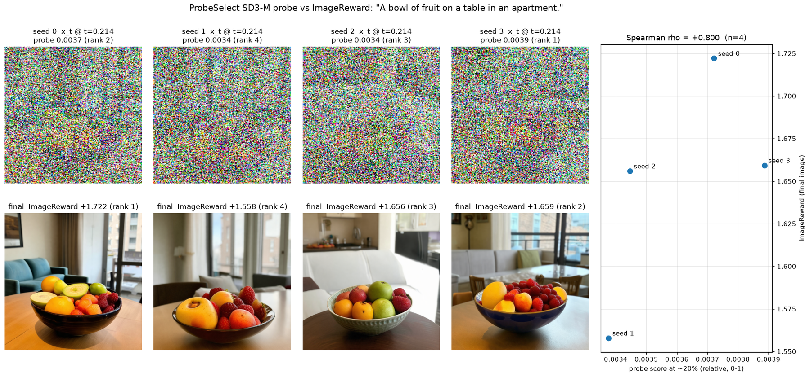

## 2. The `[0::2]` bug in ProbeSelect's data generator

`ActivationGrabber_SD3` keeps `output[1][0::2]` of transformer block 20. Diffusers orders the CFG batch
`[uncond_1..uncond_B, cond_1..cond_B]`. With the README's `--batch-size 2`, rows 0 and 2 are kept, and **both belong to
image 1** (unconditional and conditional). Image 2's features are never recorded, and the second stored feature is
labelled with image 2's score.

We confirmed this empirically: hooking a real UNet step, the kept rows have identical noisy latents. At batch size 1
there is no mismatch, but the slice then keeps only the unconditional row.

## 3. The released probe on 10 prompts × 8 seeds (1024px)

Prompt p00 is the fruit bowl. The others are T2I-CompBench++ val prompts across all 8 categories. Seeds 0–3 of p00
reproduced §1 bit for bit.

| Metric | Released probe | Chance / baseline |
|---|---|---|
| Mean Spearman ρ (median) | **−0.055** (−0.12); 3 of 10 prompts positive; sign-flip p = 0.67 | 0 |
| Top-1 picks (best of 8) | **0 / 10** | 1.25 |
| Mean ImageReward of the pick | +1.165 | random +1.199, best of 8 +1.384 |

**Diagnostics** (`diagnose.py`): we re-ran all 80 candidates and re-scored them under 20 variants:
- steps 5, 8, 11, 16 and 22 (t = 0.21 … 0.82);
- unconditional vs conditional CFG row;
- time label i/28 vs (i+1)/28.

No variant helped: the best mean ρ was +0.03. The score spread across all candidates is 18× the spread for random
inputs with matched statistics (std 0.0027 vs 0.00015), so the probe is not dead. But the spread *within* a prompt is
only about 0.0003. **The probe separates prompts, not candidates of the same prompt.**

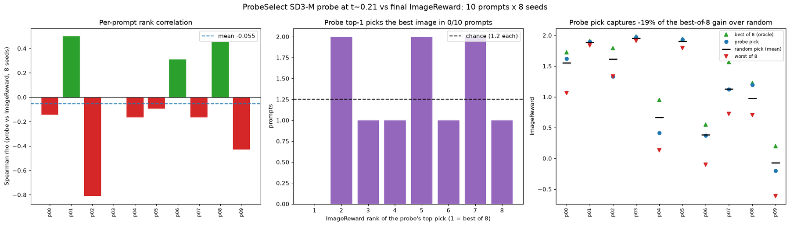
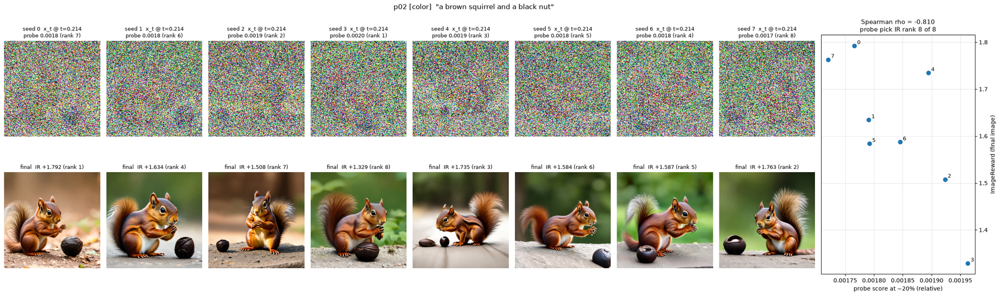

## 4. A 512px dataset with full trajectories

To train our own predictors, we generated a dataset at 512px (`gen512.py`). Generation is about 3× faster than at
1024px, and the spread of quality within a prompt is about 2× larger.

| Setting | ImageReward spread within a prompt (std) | Best of N minus a random pick |
|---|---|---|
| 1024px, 8 seeds | 0.16 | 0.18 |
| 512px, the same 8 seeds | 0.29 | 0.28 |
| 512px, 16 seeds | 0.29 | 0.36 |

What the dataset contains:
- **25 evaluation prompts** (T2I-CompBench val) and **157 training prompts** (T2I-CompBench train, shuffled and
  category-balanced), 16 seeds each, giving 2,912 candidates.
- For every candidate: block-20 PCA features of both CFG rows at all 28 steps, the initial noise, x_t after every
  step, the final image and its ImageReward score. That is about 280 MB per prompt and about 50 GB in total, so it is
  not in the repo. It can be regenerated with `gen512.py`.
- Easy categories: color and spatial (about +1.3 to +1.8). Hard ones: shape, complex, 3D spatial and non-spatial
  (about +0.3 to +0.8).

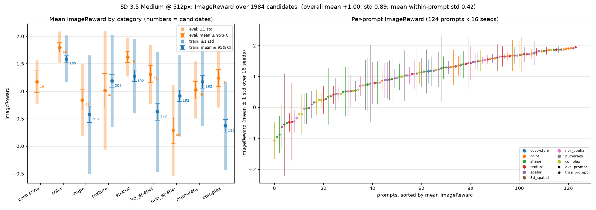

## 5. Our own probes on ProbeSelect-style features

**Neural probe** (`ProbHead`, conditional row, correctly paired, within-prompt ranking loss, ~93 training prompts).
It overfits:
- at step 5, training loss fell from 0.99 to 0.45 while evaluation ρ stayed at about −0.04 to −0.09;
- a sanity check on **step 27 (the final step)** was also at about 0 by epoch 12.

**Ridge probe** on sign-invariant summaries of the per-sample PCA features (per-component energy plus |x| spatial
maps), centered within each prompt (`simple_probe.py`, 107 training prompts):

| Step (t) | Cond, eval ρ | Uncond, eval ρ | Cross-validation ρ (cond / uncond) |
|---|---|---|---|
| 5 (0.21) | +0.13 | +0.01 | +0.03 / +0.01 |
| 13 (0.50) | +0.17 | +0.14 | +0.04 / +0.04 |
| 20 (0.75) | +0.15 | +0.21 | +0.10 / +0.09 |
| 27 (1.00) | +0.14 | +0.16 | +0.11 / +0.09 |

Even at t = 1.0 the signal is weak. **The features themselves are the bottleneck:** per-sample PCA gives every image
its own arbitrarily signed basis, and block 20 compressed this way doesn't expose prompt alignment well.

## 6. Training-free baseline: ImageReward on x̂₀

From the saved trajectory, the guided velocity at step i is exact:
v = (x_{i+1} − x_i)/(σ_{i+1} − σ_i). From it, x̂₀ = x_i − σ_i·v. We decode x̂₀ and score it with ImageReward.

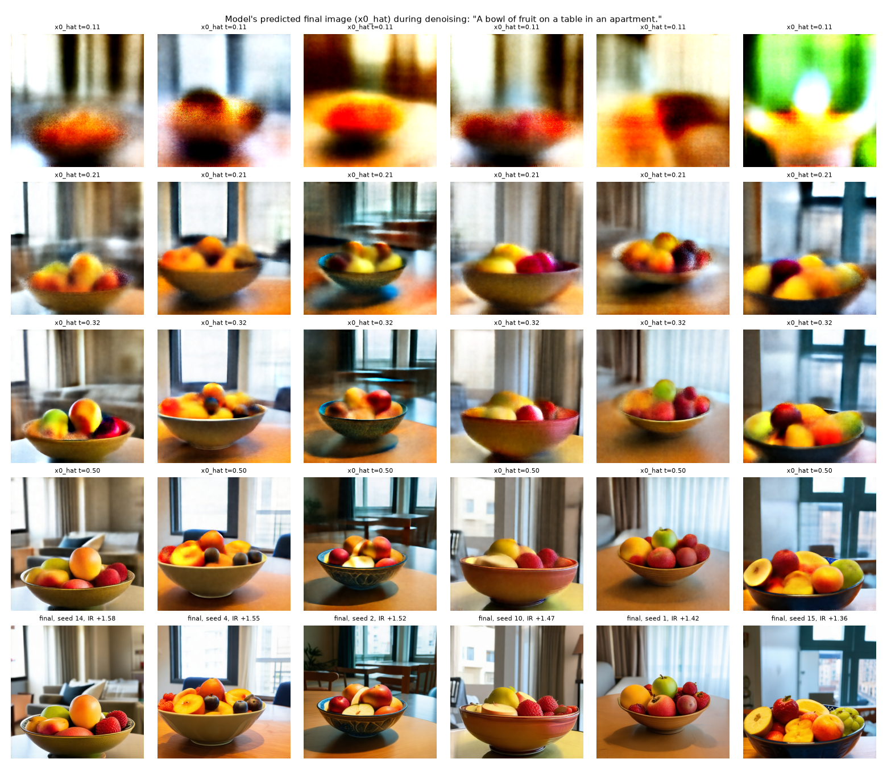

Comparing it with learned predictors at each step (`combo_probe.py`). The table shows within-prompt ρ, out-of-fold
over 127 training prompts, with the 25 evaluation prompts in brackets:

| t | A: x̂₀ IR score (no training) | B: PCA probe | C: ridge on x̂₀ IR embedding | E: C + B |
|---|---|---|---|---|
| 0.14 | −0.03 (+0.06) | +0.03 (+0.07) | +0.05 (+0.14) | +0.06 (+0.16) |
| 0.21 | **+0.14 (+0.22)** | +0.05 (+0.18) | +0.15 (+0.26) | +0.14 (+0.28) |
| 0.29 | +0.26 (+0.32) | +0.06 (+0.16) | +0.26 (+0.31) | +0.26 (+0.31) |
| 0.32 | +0.33 (+0.45) | +0.06 (+0.14) | +0.33 (+0.45) | +0.33 (+0.46) |
| 0.39 | +0.47 (+0.57) | +0.08 (+0.14) | +0.47 (+0.57) | +0.47 (+0.57) |
| 0.50 | **+0.66 (+0.70)** | +0.09 (+0.15) | +0.66 (+0.69) | +0.66 (+0.69) |

- **The x̂₀ score alone (A) is the signal.** Learning on its embedding adds at most about 0.01–0.02 at the earliest
  steps, and adding the PCA probe adds nothing.
- **There is no knee in the curve.** Prediction improves steadily with t, so choosing when to decide is a
  compute-versus-accuracy trade-off.

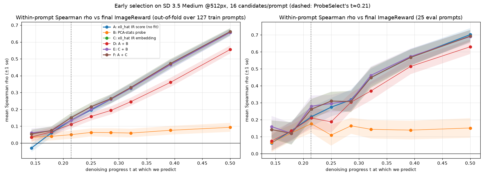

## 7. Steering by branching at t ≈ 0.29 (50 prompts)

The procedure, for each prompt:
1. Keep the top 4 of 16 by x̂₀ score at step 7 (t ≈ 0.29).
2. Branch each into 4 by re-noising:
   x′ = (1−σ)·x̂₀ + σ·(√(1−η²)·ε̂ + η·ξ), where ε̂ is the noise implied by the current state and ξ is fresh noise.
3. Run all 16 branches to t = 0.5, pick the best by x̂₀ score, and finish it.

Our sampler reproduces the pipeline bit for bit.

| Method | Mean final ImageReward | Compute (full generations) | vs select at t = 0.5 |
|---|---|---|---|
| Random single sample | +1.13 | 1 | −0.42 ± 0.06 |
| Select best of 16 at t = 0.29 | +1.37 | 5.8 | −0.17 ± 0.06 |
| **Select best of 16 at t = 0.5** | **+1.54** | 8.5 | — |
| Steer, η = 0.5 | +1.54 | 9.1 | −0.00 ± 0.03 |
| Steer, η = 1.0 | +1.56 | 9.1 | +0.02 ± 0.02 |
| Best of 16 by final score (oracle) | +1.64 | 16 | +0.09 ± 0.03 |

Steering ties with selection (25 wins, 25 losses at η = 1). The decision at t ≈ 0.29 is weak (ρ ≈ 0.26), and
re-noising mostly re-rolls details, so the branches behave like new seeds.

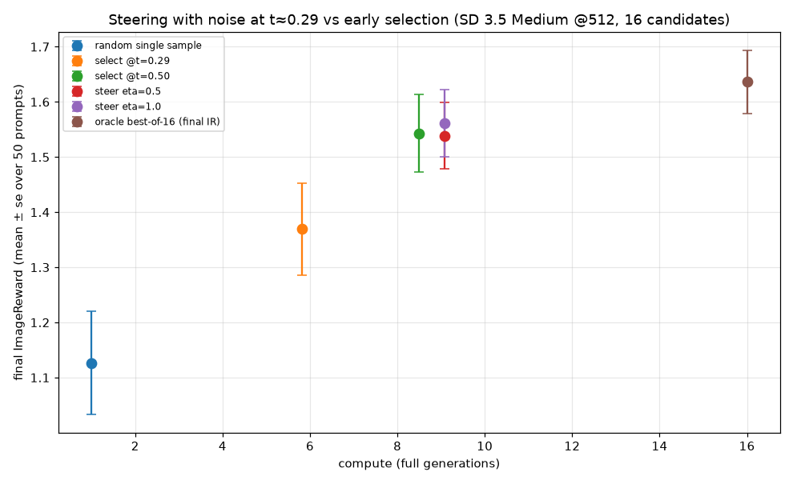

## 8. What does noise do? A visual sweep

`explore_noise.py` applies increasing noise to the best candidate at t ≈ 0.29 (σ = 0.88) in two ways:
- **η**: same σ, a growing fraction of fresh noise;
- **rewind**: re-noise x̂₀ to an earlier step, where step 0 means pure noise.

| Prompt | Original | η = 1 (details redrawn) | Rewind to step 2 (new layout) |
|---|---|---|---|
| Fruit bowl | +1.58 | +1.64 | +1.57 |
| Dog panting | +0.90 | **+1.20** (4 of 4 beat it) | +0.54 |
| Metal chair / laptop | −0.48 | −0.55 | −0.44 |
| Round cupcake + square wrapper | +1.33 | +1.17 | +0.79 |

**Composition is fixed by about step 4** (σ ≈ 0.95). From η = 0 to 1, only details change: fur, toppings, textures.
Rewinding to step 2 (σ 0.97) changes pose and layout, and step 0 is effectively a new seed.

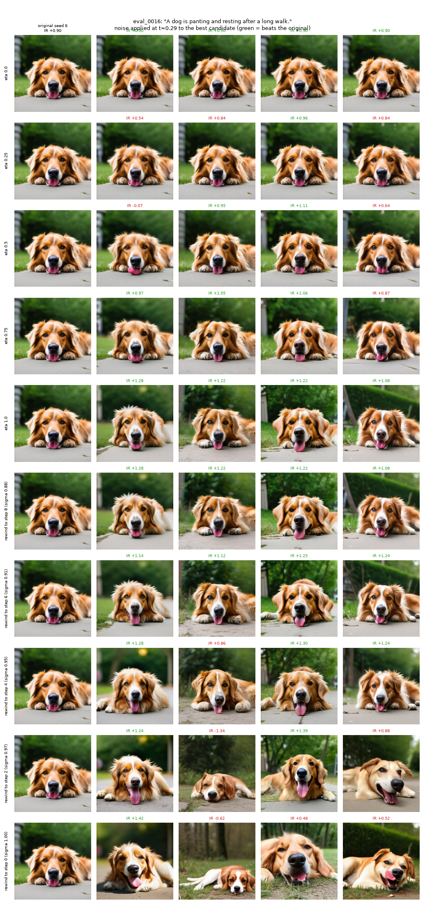
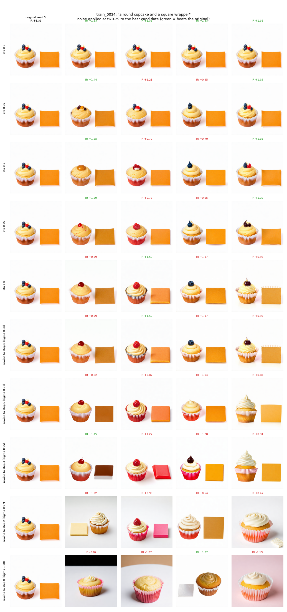

## 9. Rewinding poor candidates (partial: 13 of 25 eval prompts)

The procedure, for each prompt:
1. Judge all 16 at t = 0.5 and keep the top 4.
2. Rewind the bottom 12 to step j ∈ {8, 6, 4, 3, 2, 1, 0}, with x′ = (1−σ_j)·x̂₀ + σ_j·ξ.
3. Finish every rewound candidate and score it.

The run was interrupted by a system memory shortage after 13 prompts.

| Rewind to step (σ) | Rewound candidates: before → after (% improved) | Pool ceiling | Policy vs select at t = 0.5 | Compute |
|---|---|---|---|---|
| 8 (0.88) | +1.24 → +1.24 (50%) | +1.65 | −0.01 ± 0.01 | 11.1 |
| 6 (0.91) | +1.24 → +1.27 (63%) | +1.67 | +0.01 ± 0.01 | 11.9 |
| 4 (0.95) | +1.24 → +1.23 (53%) | +1.66 | −0.00 ± 0.00 | 12.8 |
| 3 (0.96) | +1.24 → +1.29 (62%) | +1.70 | +0.06 ± 0.06 | 13.2 |
| 2 (0.97) | +1.24 → +1.30 (58%) | +1.66 | +0.00 ± 0.01 | 13.6 |
| 1 (0.99) | +1.24 → +1.34 (64%) | +1.70 | +0.00 ± 0.02 | 14.1 |
| 0 (1.00, fresh seed) | +1.24 → +1.34 (55%) | +1.70 | +0.04 ± 0.05 | 14.5 |

- **Deep rewinds lift the weak candidates** (+0.09 on average), and they fix compositional failures that shallow
  rewinds cannot touch. Examples: a missing cube in "a cubic block and a pyramidal puzzle box", and a close-up with no
  living room for "oblong rug and circular ottoman", which went from −1.07 to +1.52 after rewinding to step 2.
- **The practical policy doesn't yet beat plain selection.** It picks by step-13 score, and it costs more compute.
- **Attribute-binding errors, such as round rugs, persist at every depth.** That is a bias in the model, not bad luck
  with the noise.
- On some prompts, intermediate depths (steps 1–3) beat a fresh seed, which suggests the half-formed image carries
  useful information. This needs the full run to confirm.

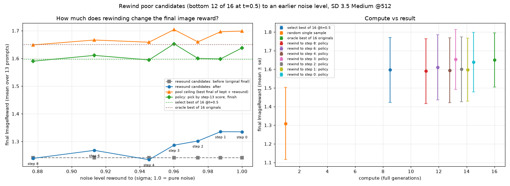
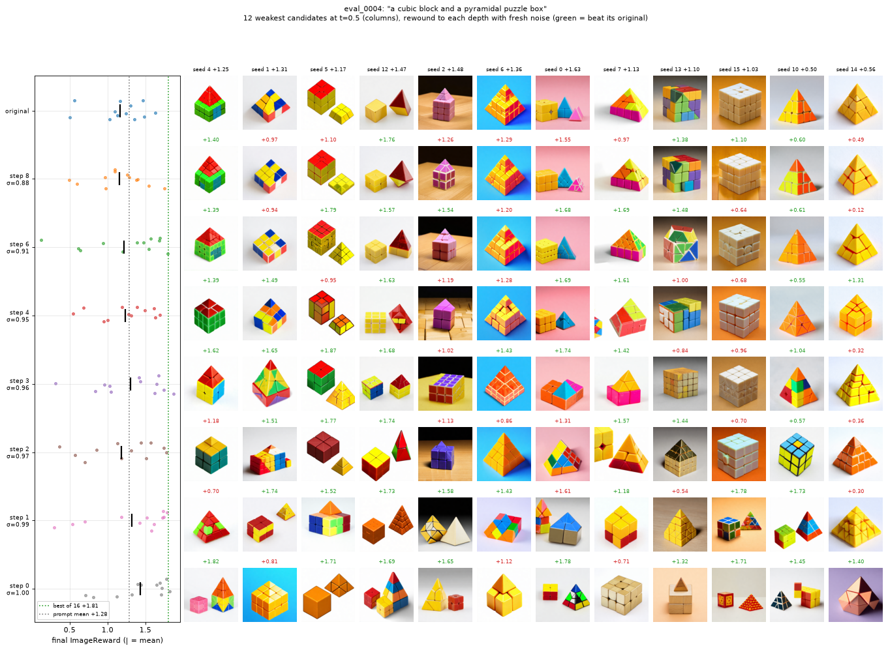
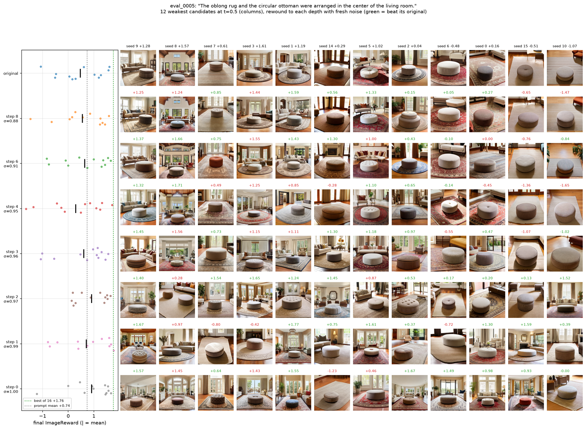

## 10. Takeaways and next steps

- **For selection, use x̂₀ + ImageReward and decide around t ≈ 0.3–0.5.** That is about 5.5–8.5 generations' worth of
  compute for best-of-16, capturing 60–82% of the oracle gain. ProbeSelect-style probes on block-20 PCA features did
  not beat it in any setting we tried.
- **The core tension:** composition, which drives most compositional-prompt failures, is decided at σ ≈ 1.0–0.95,
  but quality only becomes predictable from about t ≈ 0.25 onward.
- **Next experiments:**
  1. **Reward-gradient noise optimization (ReNO-style).** Backpropagate ImageReward(x̂₀ at about t = 0.3–0.5) into
     the early latent, which tests whether gradients can find better compositions than re-rolling.
  2. Finish the rewind run (12 prompts left) and run `rewind_draws.py`: 16 draws per depth on one image, to see how
     far a single image can move.
  3. If (1) works, use the optimized noises as training data for a learned noise transform ("golden noise").

### Caveats

- ImageReward is both the metric and the selector. Gains are measured with the same model that picks the winner,
  so a held-out reward model (for example HPSv2 or PickScore) should be checked.
- Most results use 25–50 prompts at 512px. The 1024px results (§1–3) use the released probe's own resolution.
- The released-checkpoint findings concern that checkpoint with its published inference code. They are not a verdict
  on the ProbeSelect method itself.
